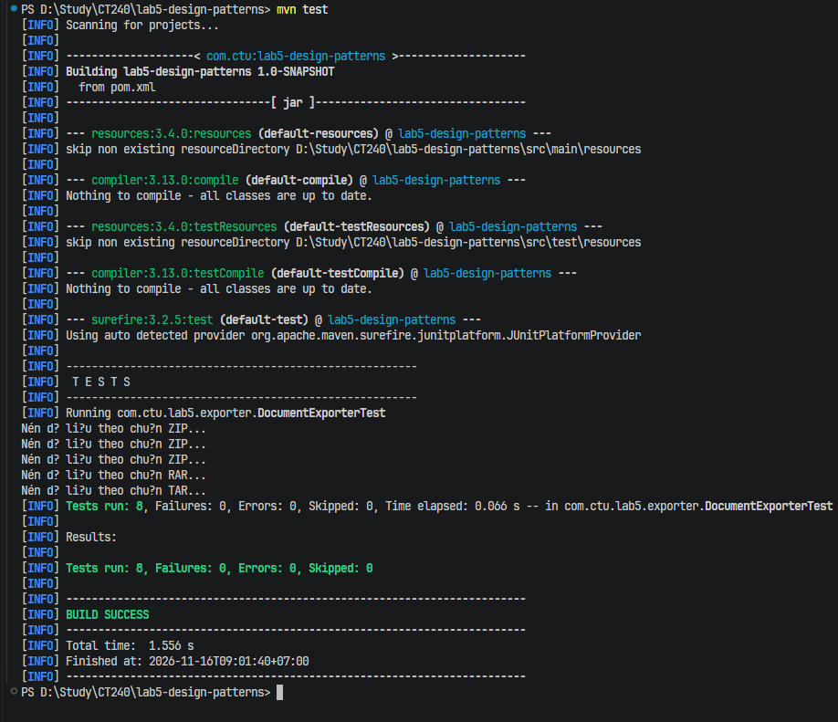
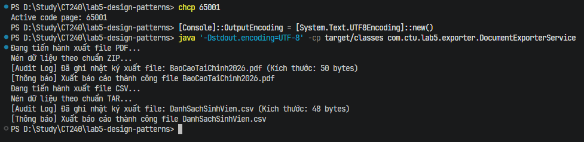

# Document Exporter System — CT240

Bài thực hành Java 17 / Maven kết hợp Factory, Strategy và Observer theo skeleton của đề bài. Đọc tài liệu và nén dữ liệu được **mô phỏng bằng chuỗi**, không đọc file thật hay tạo tệp ZIP/RAR/TAR.

## Chạy bài

Yêu cầu JDK 17 trở lên và Maven. Mở `pom.xml` trong IntelliJ IDEA dưới dạng Maven project, chọn Load Maven Changes.

```powershell
mvn test
java -Dstdout.encoding=UTF-8 -cp target/classes com.ctu.lab5.exporter.DocumentExporterService
```

Cũng có thể chạy trực tiếp hàm `main` trong IntelliJ. Chọn encoding UTF-8 nếu console hiển thị sai tiếng Việt.

## Ba pattern

| Pattern | Thành phần | Vai trò |
| --- | --- | --- |
| Factory | `DocumentReaderFactory`, `DocumentReader`, `PDFReader`, `DocxReader`, `CsvReader` | Chọn bộ đọc theo loại file PDF/DOCX/CSV, không phân biệt hoa thường. |
| Strategy | `CompressionStrategy`, `ZipCompressionStrategy`, `RarCompressionStrategy`, `TarCompressionStrategy` | Thay thuật toán nén bằng `setCompressionStrategy` ngay khi chạy. |
| Observer | `ExportObserver`, `AuditLogObserver`, `ConsoleNotificationObserver` | Đăng ký nhận sự kiện xuất thành công theo thứ tự `attachObserver`. |

Factory của skeleton dùng một phương thức static và switch (thường gọi chính xác hơn là Simple Factory); bài giữ cấu trúc này theo đề.

## Luồng chạy và OCP

`main` chạy PDF + ZIP trước, sau đó đổi sang CSV + TAR trên cùng service. Mỗi lần xuất: factory tạo reader → reader trả nội dung → strategy trả byte[] → hai observer nhận tên file và số byte.

Để bổ sung CSV: thêm `CsvReader.java` và nhánh CSV trong factory. Để bổ sung TAR: thêm `TarCompressionStrategy.java`, truyền instance vào setter. Phương thức `exportDocument` được giữ nguyên skeleton, không thêm điều kiện riêng cho CSV hoặc TAR. Đây là minh chứng OCP ở lớp service; factory vẫn cần thêm nhánh khi có định dạng mới theo thiết kế đề bài.

Tất cả strategy dùng UTF-8 tường minh để kích thước byte nhất quán giữa các máy. Audit log và thông báo chỉ in ra console theo skeleton.

## Kiểm thử

`DocumentExporterTest` gồm 8 test: thiếu strategy và thông báo lỗi chính xác; CSV + TAR; định dạng không hỗ trợ; không thông báo khi thiếu strategy; thông báo đúng một lần và đúng kích thước; đổi ZIP/RAR và đọc DOCX; loại file null; thứ tự observer và không thông báo khi định dạng không hỗ trợ.

## Kết quả chạy

### Kiểm thử JUnit 5


### Chạy chương trình
